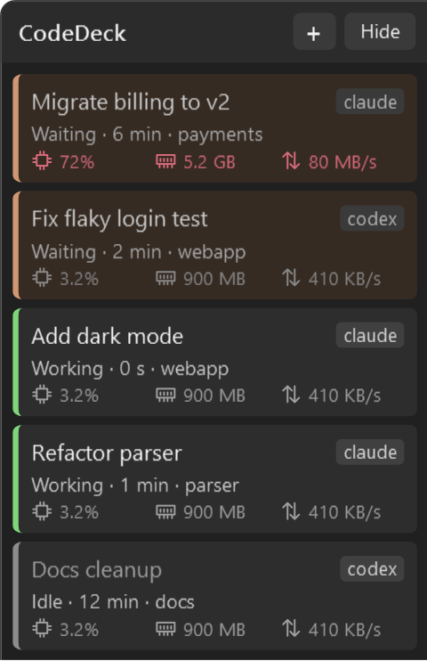
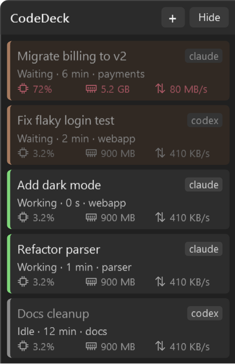

# NodLight

A strip of cards on the edge of your screen that shows which of your Claude Code and Codex sessions is waiting for you. One card per Alacritty window. Click a card, land in that window.

<p>
  
  
</p>

<sub>Sample data. The strip follows the Windows light or dark mode.</sub>

## Why this exists

I run six or seven Alacritty windows at once, each with a Claude Code or Codex session in it. The agents do their work, then stop and wait: for a permission, for an answer, or because they finished. They don't tell you. I would be reading one window while another sat on a permission prompt.

Alt-Tabbing through all of them to find the one that needs me was the whole problem. NodLight puts the answer on screen all the time: orange and blinking means a session needs you, green means it is working, grey means it is idle.

The idea comes from [ghossty-dock](https://github.com/andrewbakercloudscale/ghossty-dock), a patched Ghostty for macOS with a session sidebar. NodLight does the same job as a separate app that watches normal, unmodified Alacritty windows from outside.

## What you get

- **One card per session.** Window title, a `claude` or `codex` badge, the status with how long it has been in it, and the project folder.
- **Status you can read at a glance.** Orange with a slow blink: waiting for you (a permission prompt, or it finished its turn). Green: working. Grey: idle. A finished turn goes grey once you have looked at that window.
- **Resource use per session.** CPU, memory and disk/network I/O of everything running under that window, including the builds and test runs the agent starts. Values turn red when they get high (50% CPU, 4 GB, 50 MB/s).
- **Click to focus.** The window comes to the front, restored if it was minimised.
- **Stays out of the way.** Anchored to the bottom-right corner of the primary monitor, as tall as it needs to be. **Hide** tucks it away, **+** opens a new Alacritty window.
- **A taskbar button.** Click it to show or hide the strip. Hovering shows how many sessions you have and how many are waiting, working and idle. Right-click for New, Hide, and the hook install and removal commands.
- **Follows Windows.** Light or dark mode and accent colour.

## Install

Grab the latest build from the [Releases page](https://github.com/jnury/NodLight/releases). Windows 11 and Alacritty are required.

| File | When to use it |
|---|---|
| `NodLight-<version>-win-x64.msi` | The installer. Adds a Start menu entry and an entry in Windows Settings, under Apps. |
| `NodLight-<version>-win-x64-portable.zip` | Unzip anywhere and run `NodLight.exe`. Nothing else to install. |

Both include the .NET runtime, so you don't need to install it separately.

### The installer

Setup asks who the install is for:

- **Just for me** (the default): installs under `%LocalAppData%\Programs\NodLight`. No administrator rights needed.
- **For everyone**: installs under `C:\Program Files\NodLight` for every user of the computer. Windows asks for administrator rights.

For a silent install, the default is "just for me". Pass `ALLUSERS=1` for everyone:

```powershell
msiexec /i NodLight-1.0.0-win-x64.msi /qn
msiexec /i NodLight-1.0.0-win-x64.msi /qn ALLUSERS=1
```

**Updating:** run a newer MSI. Setup closes a running NodLight, replaces the files and offers a "Start NodLight" box on its last page, ticked by default. Your hooks and settings stay as they are, and the strip refreshes its hook helper the next time it starts. To update the portable zip, quit NodLight and unzip over the old folder.

If setup misbehaves, run it with a log and read `install.log`:

```powershell
msiexec /i NodLight-1.0.0-win-x64.msi /l*v install.log
```

## First run

Start NodLight. It does two things once:

1. Copies its small hook helper, `nodlight-hook.exe`, to `%LOCALAPPDATA%\NodLight`.
2. Adds its hooks to `~/.claude/settings.json` and `~/.codex/hooks.json`, after showing a dialog. Each file is backed up once as `<file>.nodlight.bak`. Your other hooks and settings are left alone, and so is Codex's `notify` setting.

**Codex needs one more step.** Run `/hooks` in Codex and trust the NodLight hooks. Until you do, Codex ignores them.

If a Codex window never gets a card, start Codex with `codex --no-daemon`. When Codex hands the work to a background server, the hooks don't fire from your window.

Cards appear when a session sends its first event. Agents that were already running when NodLight started show up as idle straight away, then switch to the real status on their next event.

## Using it

| You want to | Do this |
|---|---|
| Jump to a session | Click its card |
| Hide or show the strip | **Hide** button, or click the taskbar button |
| Open a new terminal | **+** button, or **New** in the taskbar button's right-click menu |
| Reinstall or remove the hooks | Right-click the taskbar button, **Install hooks** or **Remove hooks** |
| Quit | Right-click the taskbar button, **Close window** |

The strip keeps a log at `%LOCALAPPDATA%\NodLight\deck.log`: one line when it starts (version, process id, where it runs from), how many running sessions it found, what the hook setup did, and any error. It starts over when it reaches 256 KB.

### Uninstall

1. Right-click the taskbar button and choose **Remove hooks**. This removes only NodLight's entries.
2. Uninstall from Windows Settings (MSI; setup closes a running NodLight first), or delete the folder (portable).
3. Delete `%LOCALAPPDATA%\NodLight`.

## How it works

Claude Code and Codex can run a command on events such as a prompt being submitted, a tool being used, a permission being requested, or a turn finishing. NodLight installs `nodlight-hook.exe` for those events.

The helper reads the event from stdin, walks up its parent processes until it finds the `alacritty.exe` that owns the terminal, and sends one message to the strip over a named pipe. It gives up after about 200 ms, prints nothing and always exits 0, so a hook can't slow down or break an agent, even when the strip isn't running. It is a Native AOT executable to keep the start-up cost low.

On top of the hooks:

- Esc fires no hook, so the strip watches the session's transcript file for the interrupt and sets the card to idle.
- Claude Code puts a status glyph at the start of its window title (`✳` idle, a spinning half-disc while it works). The strip reads it as a second signal and strips it from the name it shows.
- Agent runs started from inside a session (`claude -p`, `codex exec`) are ignored, so they don't change the card.

Nothing leaves your machine. The strip talks only to the helper, over a local named pipe.

## Limits

- Windows 11 and Alacritty only. Windows Terminal, WezTerm and the rest are not supported.
- It assumes one `alacritty.exe` process per window, which is Alacritty's default.
- It can't tell when a session has subagents running.
- After you approve a permission prompt, the card stays orange until the tool finishes.
- A question from Claude Code's `AskUserQuestion` tool shows as working, not waiting.
- Sessions found at start-up show as idle until their next event, even if they are busy.

## Build from source

You need the .NET 10 SDK and Visual Studio (or the Build Tools) with the **Desktop development with C++** workload. The hook helper is published with Native AOT, which needs the MSVC linker, and the linker lookup needs `vswhere.exe` on `PATH`. The build prepends the default Visual Studio Installer folder for that step. If yours is elsewhere, add it yourself:

```powershell
$env:PATH = "C:\Program Files (x86)\Microsoft Visual Studio\Installer;$env:PATH"
```

```powershell
dotnet build
dotnet test
.\src\NodLight.App\bin\Debug\net10.0-windows\NodLight.exe
```

To try it without touching your real Claude Code and Codex configuration, point it at scratch folders first:

```powershell
$env:NODLIGHT_PROFILE_DIR = "$env:TEMP\nodlight-sandbox\profile"
$env:NODLIGHT_INSTALL_DIR = "$env:TEMP\nodlight-sandbox\install"
.\src\NodLight.App\bin\Debug\net10.0-windows\NodLight.exe
```

Only one strip runs per Windows user, so quit your normal one first.

The code is split into `NodLight.Core` (status logic, hook config merging, process and window helpers, the pipe), `NodLight.Hook` (the helper), `NodLight.App` (the WPF strip) and the tests in `tests/`.

### Releases

Pushing a tag like `v1.2.3` runs the [release workflow](.github/workflows/release.yml), which runs the tests, builds the portable zip and the MSI, and attaches both, with SHA-256 checksums, to a GitHub release. The MSI is built with WiX from `installer/`. To build it locally, publish the app first and pass the absolute path of the publish folder. Use `-t:Rebuild` when you change the version, because the installer project doesn't notice a version change on its own:

```powershell
dotnet publish src/NodLight.App -c Release -r win-x64 -p:SelfContained=true -o $PWD\artifacts\publish
dotnet build installer -c Release -t:Rebuild -p:Version=1.0.0 -p:PublishDir=$PWD\artifacts\publish
```

The icons are generated by `tools/make-icon.ps1`.
